# 00 — Proceso agéntico end-to-end

Este documento define **cómo** un equipo de agentes (Claude Code + subagentes) investiga, especifica,
construye, prueba y lanza la app. El orquestador es `CLAUDE.md`; los roles están en `.claude/agents/`.

```mermaid
flowchart LR
    U["Humano / Product Owner"] --> O["Orquestador (CLAUDE.md)"]
    O --> F0["F0 Investigación<br/>re-analyst + product-analyst"]
    F0 -->|"gate: clean-room review"| F1["F1 Especificación<br/>product-analyst + curriculum-designer"]
    F1 -->|"gate: content-validate"| F2["F2 Backend<br/>backend-engineer + speech-ai-engineer"]
    F2 -->|"gate: tests + cobertura"| F3["F3 QA local y cloud<br/>qa-engineer"]
    F3 -->|"gate: smoke verde"| F4["F4 Seguridad<br/>security-reviewer"]
    F4 -->|"gate: 0 high/critical"| F5["F5 Mobile<br/>mobile-engineer"]
    F5 --> F6["F6 Release<br/>release-manager"]
    F6 -->|"aprobación humana"| U
```

## F0 — Investigación (clean-room)
- **Objetivo**: entender *qué hace* la app de referencia (flujos, tipos de ejercicio, cadencia de
  feedback, SRS) sin copiar implementación.
- **Herramientas**: REA (MCP) para análisis de comportamiento observable (capturas de red propias HAR,
  estructura de pantallas, flujos), material público (web, reseñas, papers de pedagogía).
- **Salida**: `docs/research/feature-map.md`, `docs/research/ux-flows.md` — solo descripciones
  funcionales en lenguaje natural. El revisor clean-room (`security-reviewer`) verifica que no
  haya código, textos de lecciones, audio ni assets copiados.

## F1 — Especificación
- `product-analyst` convierte la investigación en historias de usuario + criterios de aceptación
  (`docs/01-product-spec.md`).
- `curriculum-designer` produce escenarios por nivel CEFR en `content/scenarios/*.yaml`
  siguiendo `docs/03-pedagogy-and-curriculum.md`. Gate: `make content-validate`.

## F2 — Backend
- `backend-engineer`: API FastAPI, modelos, motor de lecciones, SRS, auth.
- `speech-ai-engineer`: adapters STT/pronunciación y LLM (Claude) para el roleplay guionado,
  con prompts versionados en `backend/app/llm/prompts/`.
- Gate: `make lint test` con cobertura ≥ 85 %; contratos OpenAPI exportados (`make openapi`).

## F3 — QA
- **Local**: SQLite + providers `mock` → resultados deterministas (`make qa-local`).
- **Cloud (staging)**: Cloud Run + Cloud SQL con providers reales detrás de feature flags;
  `scripts/qa-cloud.sh` ejecuta el mismo smoke contra la URL de staging.
- Conjunto de audios de prueba (generados por TTS propio) en `tests/fixtures/audio/` para validar
  STT real en staging.

## F4 — Seguridad
Checklist en `docs/05-release-and-security.md`: SAST (ruff/bandit), dependencias (pip-audit),
secretos (gitleaks), contenedor (trivy), privacidad del audio, rate limiting, JWT.

## F5 — Mobile (posterior)
Expo/React Native consumiendo el OpenAPI generado. Ver `mobile/README.md`.

## F6 — Release
Semver + changelog; despliegue a staging automático en `main`, producción manual con aprobación.

## Bucle de trabajo de cada agente
1. Leer tarea + docs relevantes → 2. Plan corto → 3. Implementar → 4. Ejecutar tests →
5. Reportar (archivos, comandos, resultados, riesgos) → 6. El orquestador valida el gate.

## Definition of Done (global)
- Tests verdes, cobertura ≥ 85 %, lint limpio, OpenAPI actualizado.
- Contenido nuevo validado y revisado por `curriculum-designer`.
- Sin secretos; cambios de seguridad revisados.
- Documentación/ADR actualizado si cambia la arquitectura.
