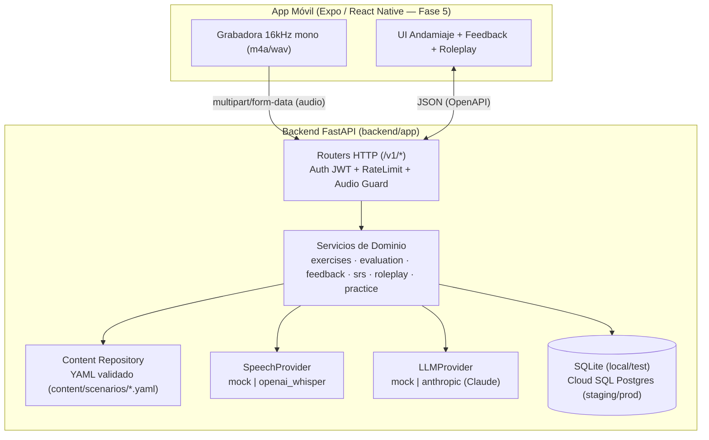

# 02 — Arquitectura Técnica (Backend, IA de Voz, Mobile y Cloud)

## 1. Capas del Backend (`backend/app/`)
- **`core/`**: [`config.py`](file:///home/antigravity/MiguelLeonardo/Languaje-learning/backend/app/core/config.py) (12-factor con `pydantic-settings` y guardas de producción) y [`security.py`](file:///home/antigravity/MiguelLeonardo/Languaje-learning/backend/app/core/security.py) (JWT HS256 + `RateLimiter` por usuario).
- **`content/`**: [`schema.py`](file:///home/antigravity/MiguelLeonardo/Languaje-learning/backend/app/content/schema.py) y [`repository.py`](file:///home/antigravity/MiguelLeonardo/Languaje-learning/backend/app/content/repository.py) cargan y validan en el arranque todos los escenarios YAML de `content/scenarios/`.
- **`services/`** (dominio puro, sin dependencias HTTP):
  - [`exercises.py`](file:///home/antigravity/MiguelLeonardo/Languaje-learning/backend/app/services/exercises.py): genera ejercicios `shadowing`, `recall`, `guided` y `completion`.
  - [`evaluation.py`](file:///home/antigravity/MiguelLeonardo/Languaje-learning/backend/app/services/evaluation.py): normaliza contracciones y alinea palabras con `SequenceMatcher`.
  - [`feedback.py`](file:///home/antigravity/MiguelLeonardo/Languaje-learning/backend/app/services/feedback.py): genera consejos en español + IPA y detecta `focus_words`.
  - [`srs.py`](file:///home/antigravity/MiguelLeonardo/Languaje-learning/backend/app/services/srs.py) y [`practice.py`](file:///home/antigravity/MiguelLeonardo/Languaje-learning/backend/app/services/practice.py): algoritmo SM-2 y persistencia de tarjetas `phrase` y `feedback`.
  - [`roleplay.py`](file:///home/antigravity/MiguelLeonardo/Languaje-learning/backend/app/services/roleplay.py): máquina de estados de conversación guionada con IA.
- **`speech/` y `llm/`**: puertos y adaptadores (`mock` determinista para local/CI, `openai_whisper` y `anthropic` Claude para staging/prod).
- **`api/routes/`**: [`system.py`](file:///home/antigravity/MiguelLeonardo/Languaje-learning/backend/app/api/routes/system.py), [`catalog.py`](file:///home/antigravity/MiguelLeonardo/Languaje-learning/backend/app/api/routes/catalog.py), [`practice.py`](file:///home/antigravity/MiguelLeonardo/Languaje-learning/backend/app/api/routes/practice.py), [`roleplay.py`](file:///home/antigravity/MiguelLeonardo/Languaje-learning/backend/app/api/routes/roleplay.py).

## 2. Paridad Local vs Cloud (QA sin fricción)
| Aspecto | Entorno Local (`ENV=local` / `test`) | Entorno Cloud (`ENV=staging` / `production`) |
|---|---|---|
| Base de datos | SQLite (`languaje.db`) o Postgres en Docker Compose | Cloud SQL for PostgreSQL 16 (IP privada) |
| Proveedor de voz | `MockSpeechProvider` (acepta `debug_transcript`) | `OpenAIWhisperProvider` (`debug_transcript` bloqueado con HTTP 400) |
| Proveedor LLM | `MockLLMProvider` (devuelve línea del guion) | `AnthropicClaudeProvider` (`claude-sonnet-4-5`) |
| Autenticación | `/v1/auth/dev-token` habilitado | `/v1/auth/dev-token` devuelve 404; JWT emitido por IdP |
| Secretos | `.env` local (ignorado en git) | Google Secret Manager inyectado en Cloud Run |

## 3. Infraestructura como Código y Despliegue
- [`backend/Dockerfile`](file:///home/antigravity/MiguelLeonardo/Languaje-learning/backend/Dockerfile): imagen multi-stage con usuario sin privilegios (`uid 10001`) y `HEALTHCHECK`.
- [`infra/docker-compose.yml`](file:///home/antigravity/MiguelLeonardo/Languaje-learning/infra/docker-compose.yml): levanta Postgres 16 + API local.
- [`infra/terraform/main.tf`](file:///home/antigravity/MiguelLeonardo/Languaje-learning/infra/terraform/main.tf): aprovisiona Artifact Registry, Cloud SQL, Secret Manager y Cloud Run v2.
- [`.github/workflows/deploy.yml`](file:///home/antigravity/MiguelLeonardo/Languaje-learning/.github/workflows/deploy.yml): despliegue sin tráfico (`--no-traffic`), ejecución de `scripts/qa-cloud.sh` contra la revisión candidata y cambio de tráfico al 100 % solo si pasa el smoke test.
