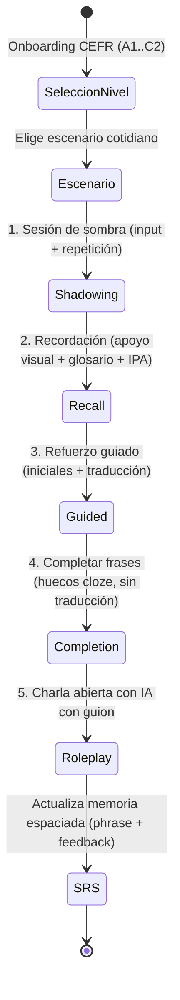

# Flujos de Usuario (UX Flows — Clean-Room)

## Flujo de un turno de voz
1. El cliente muestra el `ExercisePrompt` según el nivel de soporte (`full`, `partial`, `low`).
2. Si `audio_text` está presente (`shadowing` / `recall`), el cliente reproduce el audio modelo.
3. El usuario mantiene pulsado o activa el micrófono y pronuncia la frase completa.
4. El cliente envía `POST /v1/exercises/{id}/attempts` con el clip de audio.
5. Si `feedback.level == "retry"`, la UI resalta `feedback.focus_words` y ofrece repetir inmediatamente; además, la tarjeta `feedback` queda agendada en SRS a 10 minutos.
